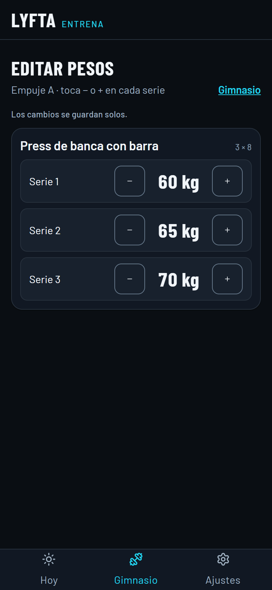
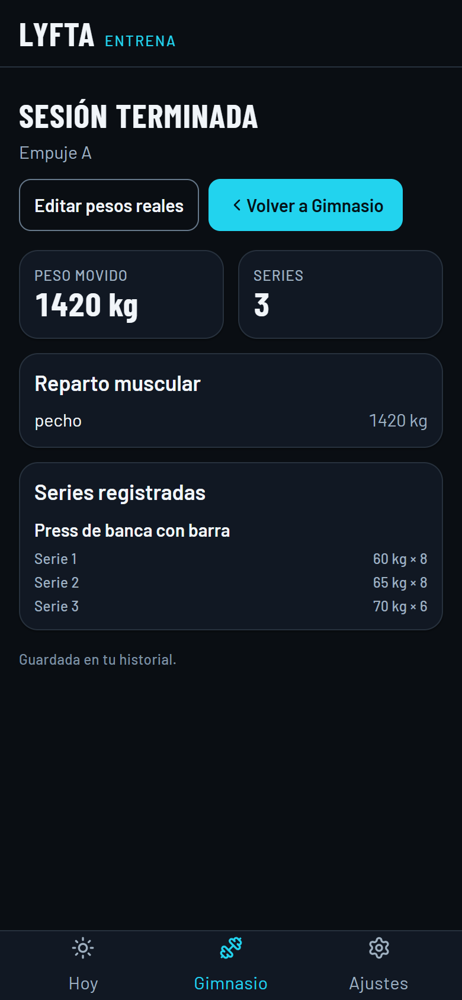
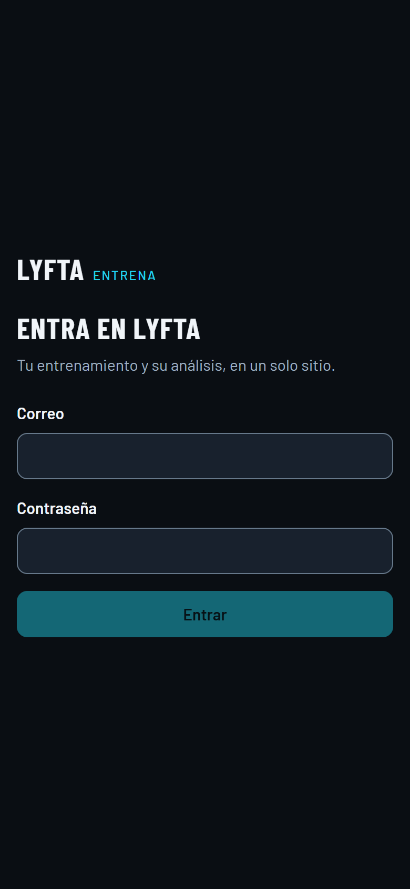

# Lyfta — app móvil para entrenar fuerza con tu reloj Garmin

**Portfolio de candidatura.** Producto real, en uso, con una sola usuaria diana (el
autor) y un recorrido completo: planificar un entrenamiento de fuerza con pesos por
serie, enviarlo al reloj Garmin desde la propia app, ejecutarlo sin teclear nada en la
muñeca, corregir los pesos reales al terminar y verlo en el historial.

- **Repositorio:** <https://github.com/ErDeivih/garmin-athletics>
- **Demo:** **<https://servidor.tail4263a0.ts.net>** — PWA servida por HTTPS con
  certificado del tailnet (WireGuard), instalable en el móvil y con arranque sin
  cobertura. Es una red privada: el enlace solo responde desde un dispositivo del tailnet
  de invitado, así que la demo se enseña en directo o por pantalla compartida.
- **Estado:** en uso desde el 2026-11-09, con PWA instalable y offline desde el
  2026-11-10. Pendiente solo la prueba física con el reloj (ver «Estado»).

---

## 1. El problema

Garmin Connect está pensado para correr y para el entreno de fuerza general; para
**progresar por series** (aproximación a 60 kg, trabajo a 65, tope a 70) obliga a crear el
entrenamiento en el móvil, esperar a que sincronice, y en el reloj acabas tecleando el
peso de cada serie o trabajando a ciegas. Al terminar, las series se pierden en un
registro genérico y no hay forma cómoda de corregir el peso real.

Lo que faltaba, en una frase: **un plan con pesos por serie que viaje al reloj y vuelva
como historial fiable**.

## 2. Qué demuestra

| Competencia | Cómo se ve en el proyecto |
|---|---|
| **Producto móvil de punta a punta** | 21 pantallas (React 19 + Vite + TypeScript): **onboarding** de tres pasos en la primera visita (con flujo visual Planifica → Envía → Entrena), biblioteca con búsqueda, filtro por foco/fecha, **duplicar plan** y **exportar/importar en JSON**; editor de pesos con **peso editable en la propia fila**, copiar-serie-anterior y peso en bloque; historial con fecha, duración, volumen y series, y detalle con **planificado vs real** en formato «60 → 62,5 kg» con diferencia resaltada y corrección posterior; flujo planificar → enviar → entrenar → corregir → historial |
| **Preferencias y portabilidad** | Ajustes con **unidades kg/lb** (los pesos se muestran y editan en la unidad elegida; al reloj va siempre kg), **tema claro/oscuro** persistente y aviso de uso sin conexión; los planes salen y entran en un **JSON versionado** para no perderlos o pasarlos a otro móvil |
| **Análisis de progreso** | Panel por ejercicio y semana: **volumen** (kg×reps), series, **mejor serie** (peso×reps) y gráfico de barras semanal (4 semanas por defecto, ampliable a 8 y 12), con selector de ejercicio y semanas vacías incluidas |
| **Plantillas reutilizables** | Guardar una sesión entrenada como plantilla, lista en la biblioteca y **aplicar la plantilla a un día concreto** creando el evento de calendario |
| **Exportación para análisis** | El historial completo sale a **CSV** (una fila por serie, lista para hoja de cálculo) o **JSON** con sus series, pesos y reps, desde la propia app |
| **Resumen semanal** | Volumen total, sesiones, series y repeticiones de la semana, **series por grupo muscular** y **adherencia al plan** (sesiones hechas frente a entrenos planificados en el calendario) |
| **Modo enfocado en el gimnasio** | Una sola serie a la vista con **peso objetivo grande**, botón de «Serie hecha», **registro rápido** de reps reales y RPE opcional y **temporizador de descanso**; uso con una mano, sin listas ni distracciones |
| **Calculadora de discos** | Dado el peso objetivo, reparte barra y discos por lado (20 k + 10 + 2.5…) y avisa si el inventario no llega; visible en la sesión y en el modo enfocado |
| **CSV previsto vs real** | Una fila por serie con **sesión (id y nombre), ejercicio, unidad**, peso y reps **previstos frente a los reales** y diferencia, exportable desde Historial; tres series exportan tres filas exactas |
| **Integración con hardware real** | API de Garmin Connect y watch-app propia en Connect IQ (Monkey C) para el Forerunner 255: mapeo de ejercicios y enums, envío del workout con objetivos por serie, series idempotentes desde el reloj, `dry_run` para validar sin tocar la cuenta, **estados honestos del envío** (Solicitado → Enviado → Confirmado, sin «Recibido» sin acuse) y **prueba de integridad plan → reloj → guardado** con tres pesos distintos (`docs/PRUEBA-INTEGRIDAD.md`) |
| **Offline y PWA** | HTTPS con certificado del tailnet; la app se instala (ventana en `display-mode: standalone`, sin barra del navegador) y **arranca sin cobertura**: recarga servida por el service worker con `onLine: false`, `transferSize: 0` y `workerStart > 0`. El borrador de la sesión se guarda en el móvil |
| **Backend de datos** | FastAPI + SQLAlchemy async + SQLite, migraciones idempotentes, 21 guiones de contrato sobre una base efímera |
| **Diseño y sistema de diseño** | Tokens de color/tipografía, contraste AA comprobado, escala de espaciado, regresión visual con `pixelmatch` (4 pantallas, 0 píxeles) |
| **Despliegue y operación** | Imagen Docker de dos etapas, servidor doméstico, acceso privado por Tailscale, verificación automática del despliegue (`verify-server.sh`), sin abrir puertos en el router |
| **Método de trabajo** | Rojo → verde en cada arreglo, sin dependencia de CI externa, evidencia en capturas e informes JSON versionados |

## 3. El flujo, en capturas

Todas están tomadas a 390 × 844 (viewport real de móvil) contra la app desplegada.

| | |
|---|---|
| **Plan con pesos por serie** — 60 / 65 / 70 kg, botones − / + y guardado automático. [03-plan-pesos.png](docs/capturas-movil/03-plan-pesos.png) | **Edición de una serie** — 65 → 67,5 kg, «Guardado a las …». [03b-edicion-serie.png](docs/capturas-movil/03b-edicion-serie.png) |
| **Envío al reloj** — un botón, estado Pendiente/Enviado/Error y guía de sincronización. [04b-envio-enviado.png](docs/capturas-movil/04b-envio-enviado.png) | **Entrenar** — las tres series con su peso y reps ya puestos. [06-entrenar.png](docs/capturas-movil/06-entrenar.png) |
| **Sesión guardada** — 60/65/70, 1420 kg, reparto muscular. [07-sesion-terminada.png](docs/capturas-movil/07-sesion-terminada.png) | **Corregir después de entrenar** — 60 → 62,5 kg persistido. [09-editar-tras-entrenar.png](docs/capturas-movil/09-editar-tras-entrenar.png) |
| **Historial** — la sesión aparece en «Últimas sesiones». [10-historial-sesion.png](docs/capturas-movil/10-historial-sesion.png) | **Sin cobertura** — la app abierta con la red apagada. [https-arranque-sin-cobertura.png](docs/capturas-movil/https-arranque-sin-cobertura.png) |
| **PWA instalada** — ventana en modo app, sin barra del navegador. [pwa-instalada-ventana.png](docs/capturas-movil/pwa-instalada-ventana.png) | **Instalada y sin cobertura** — recargada con la red apagada. [pwa-instalada-sin-cobertura.png](docs/capturas-movil/pwa-instalada-sin-cobertura.png) |
| **Biblioteca con filtros** — búsqueda por nombre, foco y fechas. [13-biblioteca-filtros.png](docs/capturas-movil/13-biblioteca-filtros.png) | **Duplicar plan** — reutilizar una rutina con sus pesos por serie. [14-biblioteca-duplicar.png](docs/capturas-movil/14-biblioteca-duplicar.png) |
| **Historial completo** — fecha, duración, volumen y series. [11-historial-completo.png](docs/capturas-movil/11-historial-completo.png) | **Planificado frente a real** — el plan (65 kg) junto al peso real. [12-planificado-vs-real.png](docs/capturas-movil/12-planificado-vs-real.png) |
| **Editor rápido** — copiar la serie anterior y aplicar un peso a todas. [16-editor-rapido.png](docs/capturas-movil/16-editor-rapido.png) | **Aplicado y guardado** — 62,5 kg en las tres series sin salir. [17-editor-aplicado.png](docs/capturas-movil/17-editor-aplicado.png) |
| **Onboarding** — tres pasos y lo que necesita el reloj. [00-onboarding.png](docs/capturas-movil/00-onboarding.png) | **Planes en JSON** — exportar e importar desde la biblioteca. [18-biblioteca-json.png](docs/capturas-movil/18-biblioteca-json.png) |
| **Ajustes** — unidades, tema y aviso sin conexión. [19-ajustes-unidades.png](docs/capturas-movil/19-ajustes-unidades.png) | **Unidades en lb** — el mismo plan en libras (137,8 lb). [20-editor-libras.png](docs/capturas-movil/20-editor-libras.png) |
| **Progreso** — volumen y mejor serie por ejercicio y semana. [21-progreso.png](docs/capturas-movil/21-progreso.png) | **Aplicar a un día** — plan al calendario en la fecha elegida. [22-aplicar-dia.png](docs/capturas-movil/22-aplicar-dia.png) |
| **Sesión → plantilla** — guardar lo entrenado como plantilla. [23-guardar-plantilla.png](docs/capturas-movil/23-guardar-plantilla.png) | **Exportar historial** — CSV o JSON desde la lista de sesiones. [24-exportar-historial.png](docs/capturas-movil/24-exportar-historial.png) |
| **Resumen semanal** — volumen, series por grupo y adherencia al plan. [25-resumen-semanal.png](docs/capturas-movil/25-resumen-semanal.png) | |
| **Modo enfocado** — serie actual, peso objetivo y botón grande. [26-sesion-enfocada.png](docs/capturas-movil/26-sesion-enfocada.png) | **Registro rápido** — reps reales y RPE opcional por serie. [27-registro-rapido.png](docs/capturas-movil/27-registro-rapido.png) |
| **Calculadora de discos** — barra y discos por lado. [28-discos-en-sesion.png](docs/capturas-movil/28-discos-en-sesion.png) | **Biblioteca** — nombre, búsqueda, foco y fechas. [29-biblioteca.png](docs/capturas-movil/29-biblioteca.png) |
| **Planificado vs real** — diferencias marcadas por serie. [30-historial-diferencias.png](docs/capturas-movil/30-historial-diferencias.png) | **Controles de sesión** — ±2,5 kg, ±1 rep y «anterior» por serie. [31-sesion-controles.png](docs/capturas-movil/31-sesion-controles.png) |

Los datos de las capturas son de una ejecución real contra el despliegue (copia
desechable de la base, sin tocar la cuenta de Garmin). Informe:
`docs/capturas-movil/informe-flujo.json`.

## 4. Evidencia de calidad

| Suite | Resultado |
|---|---|
| Frontend (Vitest + Testing Library) | **79/79 pruebas en 38 ficheros** |
| Backend (guiones de contrato con TestClient) | **25/25**, base SQLite efímera |
| Regresión visual (Playwright + pixelmatch) | **4/4 pantallas, 0 píxeles** distintos |
| PWA instalada (Chrome, ventana `--app`) | `display-mode: standalone`, service worker controlando, **arranque sin cobertura** (`onLine: false`, `transferSize: 0`, `workerStart > 0`) |
| Contraste y escala tipográfica | 52 pares AA, espaciado dentro de la escala |
| Despliegue | `verify-server.sh`: salud, rutas profundas, cabeceras y datos OK |

Método: cada arreglo empieza por una prueba que falla. Ejemplo reciente: la sesión
guardaba 60/60/60 en vez de 60/65/70 porque el borrador ignoraba `set_targets`; la prueba
`session-pesos.test.tsx` falla antes del arreglo (esperaba 60 y recibía 82,5) y pasa
después, y la corrección posterior a entrenar tiene su propio guion de contrato
(`tests/test_session_weight_correction.py`).

## 5. Decisiones de producto (lo que aporta la mirada de analista)

- **Una sola URL y un solo origen** sirven la app y la API: el móvil no tiene que saber
  dónde está el backend, y el service worker cachea un único origen.
- **Un backend por cuenta de Garmin**, porque los tokens se renuevan al usarlos; se
  documenta como regla para no invalidar la sesión.
- **El plan manda sobre la última marca**: si el plan dice 60/65/70, la sesión arranca
  con 60/65/70; la última marca solo actúa de respaldo cuando no hay objetivos.
- **Los avisos son tarjetas visibles, no mensajes escondidos**: la app muestra
  «Reloj real · pendiente» con los pasos que faltan, en vez de ocultar el estado real.
- **Privacidad del dato primero**: la app vive en la red privada, no se publica en
  Internet y no se abre ningún puerto en el router.
- **La evidencia se versiona**: capturas numeradas e informes JSON de cada pasada, para
  que cualquiera pueda comprobar lo que se afirma.

## 6. Estado

**Funcionando hoy:** modo enfocado de entrenamiento (serie a la vista, registro rápido de reps/RPE y descanso), exportación del historial a CSV/JSON, resumen semanal con adherencia, panel de progreso por ejercicio y semana (volumen, series, mejor
serie y gráfico), plantillas reutilizables (guardar una sesión como plantilla, aplicar a un
día concreto), onboarding de primera visita, ajustes con unidades (kg/lb), tema y aviso
sin conexión, exportar/importar planes en JSON, biblioteca de planes (crear, listar, buscar,
filtrar por foco y fecha, duplicar), editor de pesos por serie rápido (copiar serie anterior,
peso en bloque, guardado automático), historial completo con fecha/duración/volumen/series y
detalle con planificado frente a real, además de crear y enviar el entreno a Garmin, entrenar,
guardar la sesión, corregirla, actividades y análisis del reloj, calendario semanal, rutas y uso
desde el móvil **dentro y fuera de casa**, con la PWA instalable por HTTPS y arranque sin
cobertura.

**Pendiente:**
- **Prueba física del Forerunner 255** (reloj cargado, 2FA delante, comprobar el peso en
  el reloj y contar las repeticiones reales del detector). Es lo único que no puede hacer
  un agente; los pasos están en `PENDIENTE-PRUEBA-RELOJ.md`.
- Medición del detector de repeticiones con series reales y ajuste del algoritmo.

## 7. Tecnologías

**Frontend:** React 19, TypeScript, Vite, React Router, TanStack Query, Tailwind CSS v4 con
tokens de diseño propios, Lucide, Vitest + Testing Library, Playwright + pixelmatch.
**Backend:** Python 3.12, FastAPI, SQLAlchemy 2 async, SQLite, Pydantic v2, APScheduler,
`garminconnect`, Uvicorn.
**Reloj:** Connect IQ (Monkey C), Forerunner 255, sensores y cierre automático de serie.
**Infraestructura:** Docker multi-etapa, Debian 12, Tailscale (acceso privado), Nginx no
necesario (FastAPI sirve el build), scripts de verificación propios.
**Método:** tests en local, sin GitHub Actions; capturas y informes como evidencia.

## 8. Documentación del proyecto

- `README.md` — qué es, arquitectura, pruebas y estado, con las capturas clave.
- `DESPLIEGUE.md` — cómo está desplegado, cómo se actualiza y cómo se comprueba.
- `docs/CASO-GARMIN.md` — **caso técnico**: producto, arquitectura (PWA + Connect IQ), decisiones y qué demuestra.
- `docs/PRUEBA-INTEGRIDAD.md` — **prueba de integridad de pesos**: plan → reloj → guardado, con la tabla de las tres etapas.
- `docs/EJEMPLO-SESION.md` — **sesión de ejemplo real** de punta a punta, con capturas a 390 px, CSV y JSON guardados.
- `docs/VIA-ENVIO-RELOJ.md` — **vía de envío al reloj**: API Personal y Training API de Garmin, plan B con Connect IQ, con fuentes y fechas.
- `docs/USO-MOVIL.md` — bloque único con los 3 pasos de instalación y lo que falta para el reloj.
- `docs/revision-interfaz-movil.md` — dossier de interfaz: 17 capturas y 10 problemas con su arreglo.
- `PENDIENTE-PRUEBA-RELOJ.md` — la única parte que depende del reloj físico.
- `WALL.md` y `ESTADO-AGENTE.md` — estado y evidencias del proyecto.
