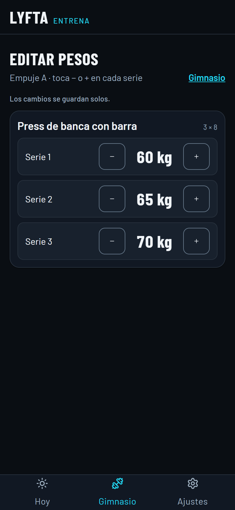
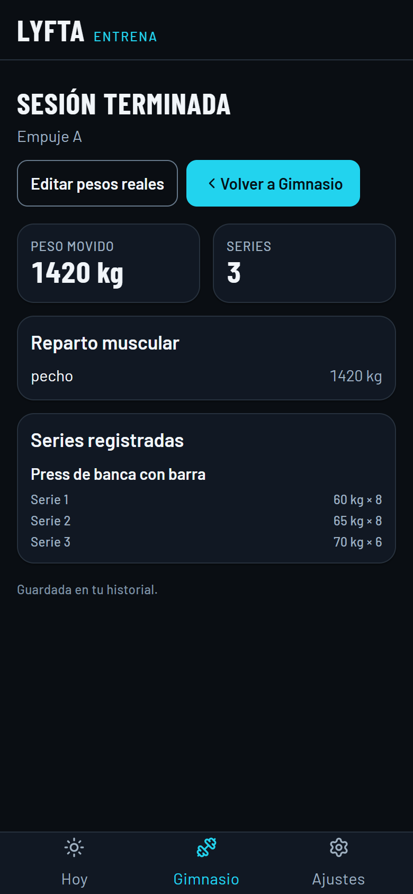
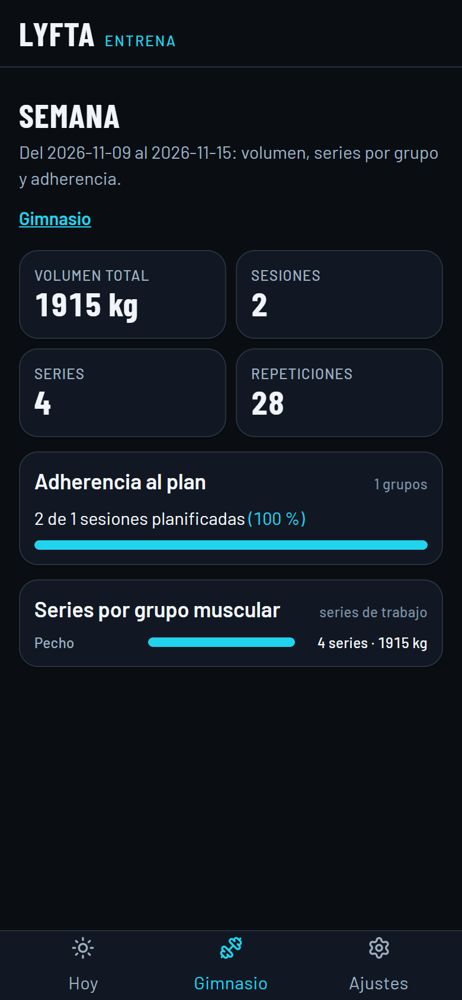
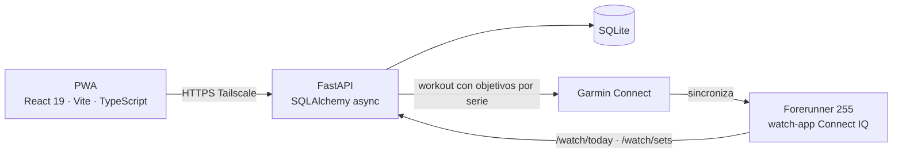

# Lyfta — entrenamiento de fuerza con reloj Garmin

**App móvil (PWA) que sustituye a Garmin Connect para entrenar fuerza:** planifica el
entrenamiento con **un peso distinto por serie**, lo envía **al Forerunner 255 desde la propia
app**, te deja entrenar sin teclear pesos en la muñeca y devuelve la sesión como historial,
progreso y resumen semanal exportable.

> Proyecto personal en uso real desde el 2026-11-09. No es una demo: el servidor sirve la app
> todos los días y la base tiene las sesiones de entrenamiento de su dueño.

| Estado | |
|---|---|
| Producto | En uso: planificar → enviar al reloj → entrenar → corregir → historial |
| PWA | Instalable por HTTPS y con **arranque sin cobertura** (verificado) |
| Pruebas | **79/79** frontend (38 ficheros) · **25/25** guiones de backend · **4/4** pantallas de regresión visual |
| Pendiente | **Prueba física con el reloj** (único punto que requiere el fr255 y el 2FA de Garmin) |

## Capturas

| Plan con pesos por serie | Sesión guardada | Resumen semanal |
|---|---|---|
|  |  |  |

Todas a **390 × 844** contra la app desplegada. Galería completa en
[`docs/capturas-movil/`](docs/capturas-movil/) (onboarding, biblioteca, editor rápido,
historial, exportación CSV/JSON, progreso, ajustes y arranque sin cobertura).

## Qué hace

- **Planificación**: plantillas con foco, día y pesos por serie; editor rápido (copiar serie
  anterior, aplicar un peso a todas, guardado automático); buscar/filtrar; duplicar planes;
  exportar e importar en JSON.
- **Reloj**: envío del entreno a Garmin con objetivos por serie y `dry_run` para validar sin
  tocar la cuenta; **watch-app propia en Connect IQ** que muestra el peso de cada serie, cierra
  la serie sola y devuelve las series de forma idempotente.
- **Entrenar**: pantalla de sesión con peso, reps, esfuerzo y «Hecha» por serie; **modo
  enfocado** de una mano (serie actual, peso objetivo grande, botón de «Serie hecha»,
  registro rápido de reps/RPE y descanso con temporizador); **calculadora de discos** (barra y
  discos por lado, con aviso si el inventario no llega); borrador guardado en el móvil que
  sobrevive a recargas y a quedarse sin cobertura; resumen con volumen y reparto muscular.
- **Historial y análisis**: lista con fecha/duración/volumen/series; detalle con
  **planificado frente a real**; corrección posterior; exportación **CSV/JSON**; progreso por
  ejercicio y semana (volumen, mejor serie, gráfico); resumen semanal con **series por grupo
  muscular** y **adherencia al plan**.
- **Producto móvil**: onboarding de tres pasos, ajustes de **unidades kg/lb**, tema
  claro/oscuro, aviso de uso sin conexión y PWA instalable.

## Arquitectura



- **Frontend**: React 19 + TypeScript + Vite, React Router y TanStack Query, sistema de tokens
  propio sobre Tailwind v4 (contraste AA comprobado), manifiesto, iconos y service worker.
- **Backend**: FastAPI + SQLAlchemy 2 async sobre SQLite, migraciones idempotentes, APScheduler,
  y el build del frontend servido **en el mismo origen** con *fallback* de rutas SPA.
- **Garmin**: `garminconnect` para subir el workout y una watch-app en **Monkey C**
  (`watch/lyfta-watch/`) para leerlo en el reloj y devolver las series.
- **Despliegue**: imagen Docker multi-etapa, servidor doméstico, acceso **solo por tailnet** con
  certificado HTTPS válido. Sin puertos abiertos en el router ni servicios públicos.

## Pruebas

```powershell
# Frontend: tokens, contraste, escala, tipos y 68 pruebas de flujo
cd frontend-nuevo; npm run check

# Backend: 24 guiones de contrato con base SQLite efímera (no tocan Garmin ni la base real)
Get-ChildItem tests\test_*.py | ForEach-Object { .\venv\Scripts\python.exe $_.FullName }

# Regresión visual (4 pantallas, pixelmatch)
cd frontend-nuevo; npm run visual
```

Método: cada arreglo empieza por una prueba que falla (rojo → verde), sin GitHub Actions; la
evidencia (capturas numeradas e informes JSON) se versiona con el código. Ejemplos: los pesos
por serie no llegaban a la sesión, el plan semanal sin planificación inventaba adherencia, el
endpoint de exportación devolvía 404 antes de existir.

## Desarrollo en local

```powershell
# Backend
python -m venv venv
.\venv\Scripts\activate
pip install -r requirements.txt
copy .env.example .env          # rellena GARMIN_EMAIL, GARMIN_PASSWORD, SECRET_KEY
.\venv\Scripts\python.exe backend\main.py        # API en http://127.0.0.1:8000

# Frontend (Vite con proxy a la API)
cd frontend-nuevo
npm install
npm run dev                     # http://127.0.0.1:5173
```

El backend sirve `frontend-nuevo/dist` cuando existe (una sola URL en producción): compílalo con
`npm run build` para probar el camino real.

## Documentación

- [`PORTFOLIO.md`](PORTFOLIO.md) — resumen de candidatura: problema, competencias y enlaces.
- [`docs/CASO-GARMIN.md`](docs/CASO-GARMIN.md) — caso técnico: producto, arquitectura y decisiones.
- [`docs/EJEMPLO-SESION.md`](docs/EJEMPLO-SESION.md) — **sesión de ejemplo real**: capturas a 390 px, CSV por serie y JSON guardados.
- [`docs/ENVIO-AL-RELOJ.md`](docs/ENVIO-AL-RELOJ.md) — **vía de envío al reloj** (API Personal, Training API y plan B con Connect IQ) con fuentes y fechas.
- [`docs/USO-MOVIL.md`](docs/USO-MOVIL.md) — instalación en 3 pasos y lo que falta para el reloj.
- [`DESPLIEGUE.md`](DESPLIEGUE.md) — despliegue, HTTPS del tailnet y operación.
- [`docs/revision-interfaz-movil.md`](docs/revision-interfaz-movil.md) — dossier de interfaz con 10 problemas y su arreglo.
- [`PENDIENTE-PRUEBA-RELOJ.md`](PENDIENTE-PRUEBA-RELOJ.md) — el único pendiente real, paso a paso.

## Privacidad

La contraseña de Garmin se usa una vez para abrir sesión y **no se guarda**; solo quedan tokens
revocables. La app no se publica en Internet: se sirve en la red de casa y por el túnel privado
del tailnet. La base y los tokens viven fuera del repositorio.
