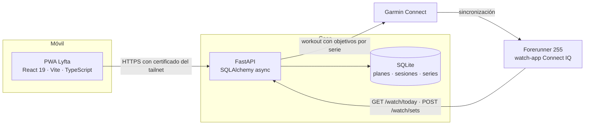
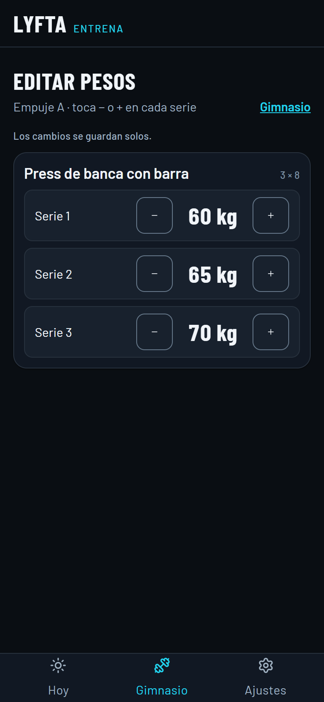
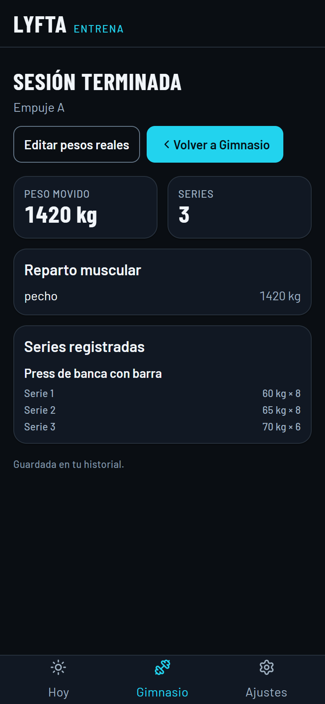
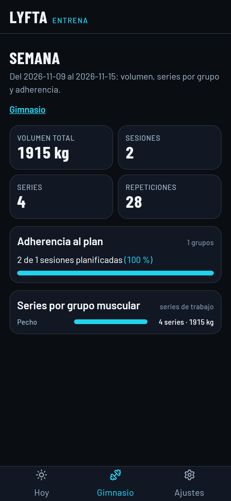

# Caso: Lyfta — app móvil propia para entrenar fuerza con reloj Garmin

Mini-informe de producto y arquitectura para el portfolio. Explica **qué se construyó, cómo
está hecho y qué demuestra**, con capturas y evidencia de calidad. Documentos hermanos:
`PORTFOLIO.md` (resumen de candidatura), `DESPLIEGUE.md` (operación),
`docs/USO-MOVIL.md` (uso real) y `PENDIENTE-PRUEBA-RELOJ.md` (lo único pendiente).

## 1. El producto en una frase

Una **PWA** que planifica entrenamientos de fuerza con **un peso distinto por serie**, los
envía **al reloj Garmin desde la propia app**, te deja entrenar sin teclear pesos en la
muñeca, guarda la sesión con sus pesos y reps, y la devuelve como historial, progreso y
resumen semanal exportable a **CSV/JSON**.

**Usuaria diana:** una sola persona (David), con un Forerunner 255 y una rutina de fuerza
con progresión por series. No es un producto comercial: es un producto **real, en uso**, con
un alcance cerrado y evidencia de cada función.

## 2. El problema

Garmin Connect está pensado para correr y para el entreno de fuerza genérico. Para progresar
por series (aproximación 60 kg, trabajo 65, tope 70) obliga a crear el entreno en el móvil,
esperar la sincronización, y en el reloj acabas tecleando el peso o entrenando a ciegas. Al
terminar, las series se pierden en un registro plano y corregirlas es incómodo.

Lo que faltaba: **un plan con objetivos por serie que viaje al reloj y vuelva como historial
fiable**, con una interfaz de una mano pensada para el gimnasio.

## 3. Qué contiene (alcance entregado)

| Área | Funciones |
|---|---|
| Planificación | Plantillas con nombre, foco, día y **peso/reps por serie**; editor rápido (copiar serie anterior, peso en bloque, guardado automático); búsqueda, filtros por foco y fecha; duplicar; **exportar/importar planes en JSON** |
| Reloj | Envío del entreno a Garmin con `dry_run`; **watch-app propia en Connect IQ** que muestra el peso objetivo de cada serie, cierra la serie sola y devuelve las series al backend de forma idempotente |
| Entrenar | Pantalla de sesión por serie y **modo enfocado** de una mano (peso objetivo, «Serie hecha», registro rápido de reps/RPE y descanso); borrador guardado en el móvil (sobrevive a recargas y a quedarse sin cobertura); resumen con volumen y reparto muscular |
| Historial | Lista con fecha, duración, volumen y series; detalle con **planificado frente a real**; corrección de pesos posterior; exportación **CSV/JSON** |
| Análisis | Progreso por ejercicio y semana (volumen, series, mejor serie, gráfico); resumen semanal con volumen, **series por grupo muscular** y **adherencia al plan** |
| Producto móvil | PWA instalable por HTTPS, arranque sin cobertura, onboarding de tres pasos, ajustes de unidades kg/lb, tema claro/oscuro y aviso de uso offline |

## 4. Arquitectura

**Frontend (PWA).** React 19, TypeScript, Vite, React Router y TanStack Query, con un sistema
de tokens propio en Tailwind v4 (color, tipografía, espaciado, contraste AA comprobado).
Manifiesto, iconos 192/512/maskable y **service worker** para arrancar sin cobertura; el
borrador de la sesión vive en `localStorage` y se rellena desde los objetivos del plan.

**Backend.** FastAPI + SQLAlchemy 2 async sobre SQLite, con migraciones idempotentes al
arrancar y APScheduler para la sincronización/auto-carga. La API sirve **también el build del
frontend** en el mismo origen (una sola URL, sin CORS en producción) con *fallback* de rutas
SPA para que recargar en `/gimnasio` no rompa.

**Integración con Garmin.** Por un lado, la API habla con Garmin Connect (`garminconnect`):
construye un workout tipado con los objetivos por serie y lo sube; `dry_run` valida el mapeo
de ejercicios sin tocar la cuenta. Por otro, una **watch-app en Connect IQ (Monkey C)**
(`watch/lyfta-watch/source/`: App, View, Model, Sensor, Api, Delegate) lee el entreno del día,
muestra «Serie 1/N · Peso (kg) · Objetivo xN» y devuelve cada serie a `/api/v1/watch/sets`
con `client_set_id`, de modo que el mismo envío dos veces no duplica.

**Datos.** Tablas clave: `workout_templates` + `template_exercises` (con `set_targets` JSON),
`workout_sessions` + `session_sets` (peso, reps, RPE, `client_set_id`, `detected_reps`),
`exercises`, `calendar_events`, `activities`, `garmin_credentials`.

**Despliegue.** Imagen Docker multi-etapa (Vite → FastAPI), servidor doméstico Debian, exposición
**solo por Tailscale** con `tailscale serve` y certificado válido en
`https://servidor.tail4263a0.ts.net`. Sin puertos abiertos en el router, sin servicios públicos.
Actualizaciones por envío de imagen (`deploy/ship-image.ps1`) y verificación automática
(`deploy/verify-server.sh`).

## 5. Decisiones de diseño que enseñan el criterio

- **El plan manda sobre la última marca.** La sesión arranca con los objetivos por serie del
  plan (60/65/70); la última marca solo actúa de respaldo cuando no hay objetivos. Antes de
  arreglarlo, la sesión se guardaba 60/60/60 y el historial mentía.
- **Una sola URL y un solo origen.** El móvil no necesita saber dónde está la API y el service
  worker cachea un único origen. La API sirve el frontend compilado.
- **Un backend por cuenta de Garmin.** Los tokens se renuevan al usarlos: dos backends
  simultáneos invalidan la sesión. Está escrito como regla operativa.
- **Avisos como tarjeta, no como mensaje escondido.** «Reloj real · pendiente» recuerda en la
  app lo que falta de la prueba física, con una bandera de configuración para apagarlo.
- **Privacidad por defecto.** El servidor no se publica en Internet; se accede por red local o
  por el túnel cifrado, y la base guarda solo datos de su dueño.
- **Honestidad en los datos.** El tonelaje excluye calentamientos, la mejor serie es peso×reps
  con desempate por peso, las semanas sin entreno aparecen a cero y la adherencia dice «sin
  planificación» en vez de inventar un porcentaje.

## 6. Qué demuestra (mirada de analista)

| Competencia | Evidencia |
|---|---|
| Traducir un problema difuso en alcance entregable | Producto cerrado y en uso: planificación, reloj, sesión, historial, análisis, exportación |
| Producto móvil de punta a punta | 21 pantallas, PWA instalable por HTTPS y **arranque sin cobertura** verificado |
| Integración con hardware real | Garmin Connect + watch-app Connect IQ para el fr255, con objetivos por serie e idempotencia |
| Datos y análisis | Exportación CSV/JSON, progreso semanal y resumen con adherencia al plan |
| Calidad y método | **69/69** pruebas frontend en 33 ficheros, **24/24** guiones de contrato backend, **4/4** pantallas de regresión visual, rojo → verde en cada arreglo, sin GitHub Actions |
| Despliegue y operación | Docker, HTTPS del tailnet, verificación automática del despliegue, sin exponer la app a Internet |
| Comunicación | Documentación operativa, guía de uso en 3 pasos, dossier de interfaz y este caso |

## 7. Las tres capturas clave

| 1. Plan con peso por serie | 2. Sesión guardada | 3. Resumen semanal |
|---|---|---|
|  |  |  |

1. **Plan con pesos por serie** (60 / 65 / 70 kg): el corazón del producto, con − / + por serie y
   guardado automático.
2. **Sesión guardada**: los tres pesos llegan al historial, con 1420 kg de volumen y el detalle
   por serie (60×8, 65×8, 70×6).
3. **Resumen semanal**: volumen, series por grupo muscular y **adherencia al plan** calculada
   contra el calendario (1 de 1, 100 %).

Todas a **390 × 844** contra la app desplegada (copia desechable de la base en las capturas de
flujo, sin tocar la cuenta real de Garmin). El resto de la galería —onboarding, editor rápido,
historial con exportación CSV/JSON, progreso, ajustes y arranque sin cobertura— está en
[`capturas-movil/`](capturas-movil/).

## 8. Estado y pendientes

- **En uso** desde el 2026-11-09; PWA instalable y offline desde el 2026-11-10; análisis y
  exportación desde el 2026-11-10.
- **Pendiente único:** la **prueba física con el Forerunner 255** (reloj cargado, 2FA delante,
  enviar el entreno, comprobar el peso por serie en el reloj y contar las repeticiones reales
  del detector). Requiere el reloj y el móvil de David; el guion está en
  `PENDIENTE-PRUEBA-RELOJ.md` y en `docs/USO-MOVIL.md`.
- **Roadmap razonable:** medir y ajustar el detector de repeticiones con series reales,
  historial de mediciones corporales y compartir planes entre usuarios.

## 9. Enlaces

- Repositorio: <https://github.com/ErDeivih/garmin-athletics>
- Demo privada (tailnet): `https://servidor.tail4263a0.ts.net` — se enseña en directo.
- `PORTFOLIO.md` · `DESPLIEGUE.md` · `docs/USO-MOVIL.md` ·
  `docs/revision-interfaz-movil.md` · `PENDIENTE-PRUEBA-RELOJ.md`
- Código: `frontend-nuevo/` (React), `backend/` (FastAPI), `watch/lyfta-watch/` (Connect IQ),
  `deploy/` (Docker y operación).
