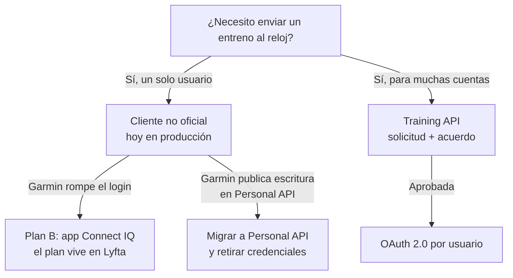

# Vía de envío al reloj con Garmin: API Personal, Training API y plan B con Connect IQ

Documento de decisión técnica. Explica **cómo llega hoy un entrenamiento de Lyfta al
Forerunner 255**, qué ofrecen las vías oficiales de Garmin, por qué se eligió la actual y qué
haría si Garmin cambiara las reglas. Revisado el **2026-11-11**.

> Regla del documento: cada afirmación lleva fuente y fecha. Garmin mueve sus páginas y sus
> condiciones; si lees esto meses después, revisa los enlaces antes de fiarte.

## Resumen en una tabla

| Vía | Qué permite | Requisito de acceso | ¿Sirve para enviar el entreno? | Estado en Lyfta |
|---|---|---|---|---|
| **Garmin Connect Personal API** (oct. 2026) | Leer tus propios datos: actividades (JSON y FIT), salud y salud de la mujer; solo *pull* | Crear una clave en Garmin Connect Web (sin solicitud) | **No consta escritura**: no sube entrenos ni los programa | No usada todavía; es la candidata a sustituir la lectura de actividades |
| **Training API** (Garmin Connect Developer Program, Business) | Empujar entrenos/planes a cuentas y dispositivos, con push y OAuth 2.0 | Solicitud al programa, caso de uso, acuerdo comercial y aprobación (Starter o Enterprise) | **Sí**, es la vía oficial | No usada: es para organizaciones, no para uso personal |
| **Cliente no oficial de Garmin Connect** (`python-garminconnect`) | Todo lo que hace la web de Garmin: subir workout, programarlo y empujarlo al reloj | Ninguno (usuario y contraseña + 2FA) | **Sí**, es lo que usa Lyfta hoy | En producción (`push-to-garmin`) |
| **App Connect IQ propia** (plan B) | La app corre en el reloj, pide el plan a nuestro backend y puede **grabar el FIT** de la sesión | SDK público de Connect IQ; nada de Garmin Cloud | **Sí, sin depender de la API cloud**: el plan lo sirve Lyfta | Implementada en `watch/lyfta-watch/` |

## Lo que usa Lyfta hoy (y por qué)

`backend/app/services/push_to_garmin.py` construye un workout de fuerza por pasos (cada serie
con su peso objetivo), lo sube con `python-garminconnect`, lo programa y lo empuja al dispositivo
del usuario. La app expone `POST /api/v1/strength/push-to-garmin` y un **`dry_run`** que valida el
mapeo de ejercicios **sin tocar la cuenta**.

Motivo de elegir esta vía: es la única que, para **un usuario particular**, permite *escribir*
entrenos en Garmin Connect sin ser una empresa. La Personal API, que sí está pensada para
particulares, está documentada como **solo lectura**; la Training API oficial sigue siendo de
programa Business.

Riesgos asumidos y mitigaciones:

- **Es un cliente no oficial** (el propio README de la librería lo dice: *"This is an unofficial
  client for Garmin's web services"*). Puede romperse cuando Garmin cambie el login.
- **No hay SLA ni contrato**: si falla, falla la subida; por eso existe `dry_run` y el estado
  «error» visible en la app.
- **El usuario entrega sus credenciales** (y su 2FA) al backend propio; no se guardan y se
  documenta en `docs/USO-MOVIL.md`. Aun así, es la razón por la que una API oficial de escritura
  sería una mejora real.
- **Un solo backend por cuenta**: dos procesos renovando tokens se pisan. Está escrito como regla
  operativa en `DESPLIEGUE.md`.

## Vía 1: Garmin Connect Personal API

Garmin reorganizó su web de desarrolladores en **octubre de 2026** y separó un apartado
**Personal** del Business. La FAQ oficial responde: *"The Garmin Connect Personal API is available
for personal use and is the quickest way to gain access to your data for use in personal
applications."* ([FAQ oficial](https://developer.garmin.com/gc-developer-program/personal/personal-faq/),
página consultada el 2026-11-11; su contenido detallado se contrastó con la guía de AIFitnessAPI,
revisada el 2026-10-22, porque la web oficial se renderiza en el navegador).

Características, según esas fuentes:

- **Clave autogenerada** en Garmin Connect Web; se canjea por un **token de acceso de 24 horas**
  (sin *refresh token*: se pide otro). La clave caduca a los 30/90/180 días o un año.
- **Solo lectura y solo pull**: actividades (JSON y `.FIT`), salud (JSON) y salud de la mujer.
- **No** está pensada para aplicaciones comerciales con varios usuarios.

**Conclusión para Lyfta:** sirve para **leer** actividades (importarlas al historial sin cliente
no oficial), pero **no** para enviar el entreno al reloj. Si Garmin añade escritura de entrenos a
la Personal API, el plan es migrar la subida y retirar el cliente no oficial.

Referencias oficiales: [Personal API](https://developer.garmin.com/gc-developer-program/personal/personal-api)
(pasos de creación de clave y endpoint de token) y
[FAQ Personal](https://developer.garmin.com/gc-developer-program/personal/personal-faq/).
Fecha de consulta: **2026-11-11**.

## Vía 2: Training API (programa Business)

El **Garmin Connect Developer Program** mantiene la **Training API** para organizaciones:
OAuth 2.0, entrega por *push*, y acceso **Starter** (inmediato, datos y herramientas básicas) o
**Enterprise** (a escala) tras **solicitud, descripción del caso de uso, acuerdo comercial y
aprobación**. Es la vía oficial para **subir entrenamientos y programarlos** en cuentas de
usuarios.

**Conclusión para Lyfta:** no aplica a un proyecto personal de un solo usuario, y no se va a
solicitar. Se documenta porque es la respuesta correcta si algún día el producto sirviera a más
gente: entonces sí, Training API + OAuth 2.0 por usuario, y Lyfta dejaría de tocar credenciales.

Referencias: [Training API](https://developer.garmin.com/gc-developer-program/training-api/) y
[Overview del programa](https://developer.garmin.com/gc-developer-program/overview/) (consultadas
el 2026-11-11). Contexto independiente sobre el modelo de acceso:
[WearLink, *Garmin Health API access*](https://wearlink.io/guides/garmin-health-api-access),
publicado el **2026-09-01**.

## Vía 3 (plan B): app propia en Connect IQ

Cuando la nube de Garmin no ofrece escritura (o cambia las reglas), el reloj puede hablar
**directamente con Lyfta**:

- **`Toybox.Communications`** permite peticiones HTTP desde la app usando el móvil como puente
  Bluetooth (*"the device to become part of the Internet of Things"*). Nuestra app pide el entreno
  del día a nuestro backend (`/api/watch/today`).
- **`Toybox.ActivityRecording`** permite grabar y guardar un FIT desde la app, con deporte y
  subdeporte (p. ej. `SPORT_TRAINING` + `SUB_SPORT_STRENGTH_TRAINING`).
- Implementación real: [`watch/lyfta-watch/source/`](../watch/lyfta-watch/source/) (App, View,
  Model, Sensor, Api, Delegate) y los endpoints `GET /api/v1/watch/today` y
  `POST /api/v1/watch/sets` (idempotente por `client_set_id`).

Ventajas: no depende de la API cloud ni de aprobaciones; el peso objetivo por serie se muestra
exacto; las series vuelven al backend aunque Garmin Connect falle. Límites: hay que instalar la
app en el reloj, el reloj necesita el móvil para hablar por HTTP, y la app **no crea el entreno en
Garmin Connect** (por eso el camino oficial sigue existiendo en paralelo).

Referencias oficiales (consultadas el 2026-11-11; documentación generada el **2026-10-30**):
[Communications](https://developer.garmin.com/connect-iq/api-docs/Toybox/Communications.html) y
[ActivityRecording](https://developer.garmin.com/connect-iq/api-docs/Toybox/ActivityRecording.html).

## Decisión

- **Hoy:** cliente no oficial + `dry_run` + aviso de estado en la app; watch-app como plan B ya
  implementado y probado en seco.
- **Disparador 1:** que la Personal API documente escritura de entrenos → migrar.
- **Disparador 2:** que Garmin rompa el login del cliente no oficial → pasar el envío a la
  watch-app como camino principal (el reloj ya sabe pedir el plan).
- **Si algún día es producto:** Training API con OAuth 2.0 y sin tocar credenciales de nadie.

## Fuentes y fechas

| Fuente | Qué se usó | Fecha |
|---|---|---|
| [Personal API (oficial)](https://developer.garmin.com/gc-developer-program/personal/personal-api) | Clave, token de 24 h, endpoint | consultada 2026-11-11 |
| [FAQ Personal (oficial)](https://developer.garmin.com/gc-developer-program/personal/personal-faq/) | Uso personal, no multi-usuario, datos y caducidad | consultada 2026-11-11 |
| [Training API (oficial)](https://developer.garmin.com/gc-developer-program/training-api/) | Escritura de entrenos, programa Business | consultada 2026-11-11 |
| [Overview del programa (oficial)](https://developer.garmin.com/gc-developer-program/overview/) | Starter/Enterprise, OAuth 2.0, push | consultada 2026-11-11 |
| [AIFitnessAPI — Personal API](https://aifitnessapi.com/fix/garmin-api-personal-use) | Contraste del contenido oficial (clave, 24 h, pull, sin escritura) | revisada 2026-10-22 |
| [WearLink — Garmin Health API access](https://wearlink.io/guides/garmin-health-api-access) | Modelo de acceso por acuerdo y entrega push | publicado 2026-09-01 |
| [Connect IQ Communications](https://developer.garmin.com/connect-iq/api-docs/Toybox/Communications.html) | HTTP desde el reloj con el móvil como puente | docs generadas 2026-10-30 |
| [Connect IQ ActivityRecording](https://developer.garmin.com/connect-iq/api-docs/Toybox/ActivityRecording.html) | Grabación y guardado de FIT desde la app | docs generadas 2026-10-30 |
| [python-garminconnect README](https://github.com/cyberjunky/python-garminconnect) | Cliente no oficial, login, escritura y advertencias | consultado 2026-11-11 |

*Próxima revisión recomendada: si Garmin cambia la Personal API o el login, o antes del
2027-05-01.*
